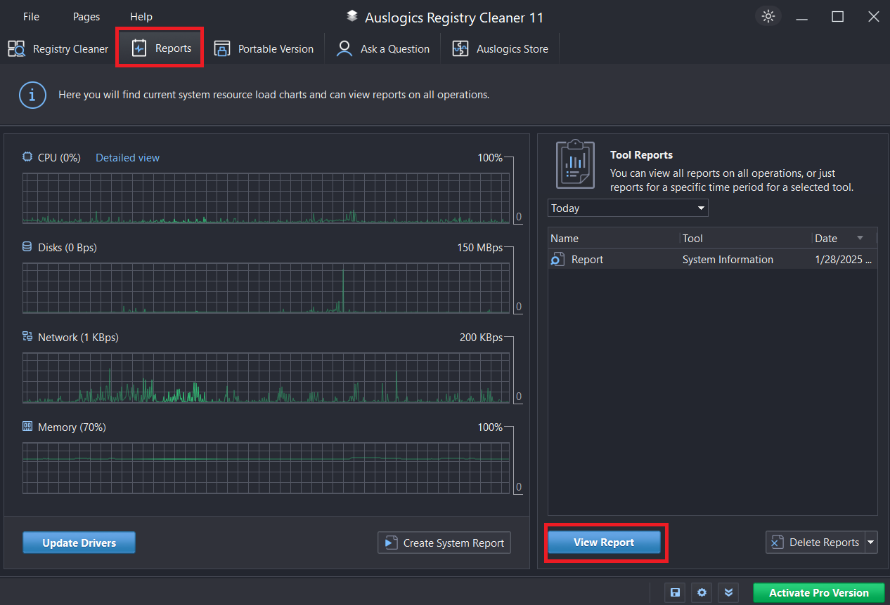
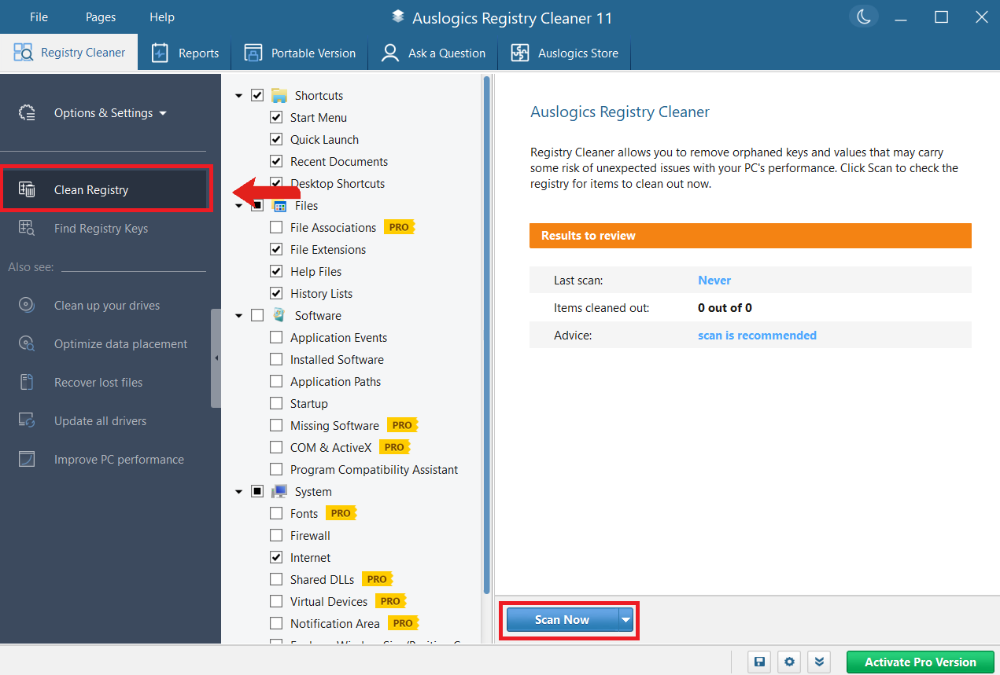

# Auslogics Registry Cleaner for Windows Registry Review

Auslogics Registry Cleaner scans the Windows registry for entries it identifies as
invalid, obsolete, or associated with missing software.
It combines categorized results, exclusions, registry search, and recovery options.

[](https://github.com/oliverha6426/auslogics-registry-cleaner/releases/)

## Main Functions

Use the application to examine a defined set of registry categories.
Review the findings before deciding which changes to apply.

- Scan selected categories for potentially invalid registry entries.
- Inspect the entries associated with a result.
- Exclude entries that should remain untouched.
- Search for registry keys using a keyword or phrase.
- Retain backups of changes through Rescue Center.
- Review reports from completed operations.
- Create a portable copy through the application's portable-version feature.

A scan result is a proposed maintenance action.
The number of findings alone does not measure the severity of a Windows problem.



## Understanding Scan Categories

Category selection determines the scope of a scan.
The available categories and advanced options depend on the edition.

| Entry type | What a finding may indicate | Review question |
| --- | --- | --- |
| File association | An extension references a missing application | Is the associated application still used? |
| Application path | A registered path no longer exists | Was the program moved or removed? |
| Shared library | A registration points to a missing library | Does another application still require it? |
| Registered font | The referenced font file is unavailable | Is the font expected to be installed? |
| Uninstalled software | Settings remain after an uninstall | Are they needed for a later reinstall? |

Check the entry's context rather than relying only on its category label.
A path on disconnected storage may be temporarily unavailable.
Retained application preferences can also be intentional.

### Scan Scope and Risk

The default selection focuses on categories Auslogics considers safer to clean.
Additional categories can involve a higher risk level.
Keep the scope narrow when investigating one application.

Record what you are trying to resolve before running the scan.
This makes it easier to judge the outcome after applying selected changes.

## Reviewing Findings

A practical review separates three decisions:

1. Whether the registry entry belongs to the software being investigated.
2. Whether its reference is actually invalid.
3. Whether removing it is appropriate for the intended maintenance task.

Leave uncertain findings unselected.
Use the ignore list for entries you deliberately want excluded from future scans.
An exclusion documents a decision to retain an entry.

### Inspect a Vendor Key with Windows Tools

The following Command Prompt example searches immediate subkey names.
Replace the sample vendor name with a name relevant to your investigation.

```cmd
set "VENDOR_NAME=ExampleVendor"
reg query "HKCU\Software" /f "%VENDOR_NAME%" /k
reg query "HKLM\Software" /f "%VENDOR_NAME%" /k
```

These are Windows reg.exe queries, not Auslogics Registry Cleaner commands.
They read matching registry information without removing entries.
HKCU and HKLM cover different settings scopes.

## Registry Search

The application's key-search feature accepts a keyword or phrase.
Use it to locate entries related to a specific investigation.

A matching word does not establish that an entry is obsolete.
Inspect the complete key path and its relationship to installed software.
Search results should be reviewed individually.

Keep a record of relevant paths when a problem needs further investigation.
This provides a clearer reference than a screenshot showing only the result count.

## Rescue Center and Recovery

Rescue Center stores backups associated with changes made by the application.
Check that backup protection is enabled before applying selected repairs.

The backup list supports viewing details and restoring a chosen backup.
Choose the backup corresponding to the operation you want to reverse.
Backup retention and storage limits can be adjusted in program settings.

### Following a Change

- Record the operation time and the application being investigated.
- Confirm that the expected backup appears in Rescue Center.
- Test the behavior that prompted the maintenance task.
- Restore the corresponding changes if the result requires reversal.

Keep independent backups for personal files and broader system recovery.
A registry-change backup has a different scope from a complete computer backup.



## Reports and Maintenance Notes

Reports provide a record of operations performed by the program.
Use the report date and operation details to connect a result with a particular run.

A useful maintenance note records:

- The symptom being investigated.
- The selected scan categories.
- Entries deliberately retained or excluded.
- The operation time and corresponding backup.
- The result of testing the affected application afterward.

Keep this information together when preparing a support request.
It helps distinguish the original issue from a change noticed after cleanup.

## Free and Pro Editions

Auslogics Registry Cleaner Pro extends the basic Free feature set.
Choose the edition according to the functions you need.

| Area | Free | Pro |
| --- | --- | --- |
| Core scanning | Basic registry analysis and cleanup | Core scanning plus advanced cleanup options |
| Registry search | Available | Available |
| Advanced categories | Limited to the Free feature set | Additional categories |
| Scheduled operation | Basic manual workflow | Scheduled scans and cleanup advertised by Auslogics |
| Support | Standard support options | Extended priority support |

Review the features shown in the installed version before creating an automated routine.
Automation repeats the selected scope; it does not replace review of that scope.

## Installed and Portable Use

The installed edition provides the normal desktop application workflow.
Auslogics Registry Cleaner portable can be created using Create portable version.
Choose the destination folder offered by that feature.

A portable copy still operates on the registry of the computer where it runs.
Check the applicable license before using it for commercial maintenance.

Keep the portable copy's version identifiable when working on several computers.
Record which computer each report or recovery backup belongs to.

## Inspecting an Entry with PowerShell

This example reads the names and data types of values in an existing sample key.
Replace the path with a key you have already identified.

```powershell
$entryPath = 'HKCU:\Software\ExampleVendor'
if (Test-Path -LiteralPath $entryPath) {
    $entry = Get-Item -LiteralPath $entryPath
    $entry.GetValueNames() | ForEach-Object {
        [pscustomobject]@{Name = $_; Type = $entry.GetValueKind($_)}
    }
}
```

This is a Windows PowerShell inspection example.
It does not classify an entry as invalid or apply a cleanup action.

## Compatibility and Current Version

Auslogics lists Windows 7, 8, 8.1, 10, and 11 as supported systems.
The product is a Windows utility; Mac and Linux versions are not listed.
Product compatibility and the operating system's own support lifecycle are separate.

The current product page identifies version 11.2.0.6, released April 29, 2026.
Use Help > About to identify the installed version when contacting support.

## Assessing the Result

Judge a maintenance task by the behavior of the affected software afterward.
A lower finding count does not establish a measurable performance improvement.
Investigate persistent errors using their specific symptoms and error messages.

Keep changes tied to an identifiable purpose.
Preserve the report and recovery information until the outcome has been checked.

## Related Search Terms

auslogics registry cleaner, auslogics registry cleaner pro, auslogics registry cleaner portable, auslogics registry cleaner setup, auslogics registry cleaner safe, registry-cleaner, windows, windows-registry, cleaner, system-maintenance, registry-backup, desktop-app, gui, windows-10, windows-11
